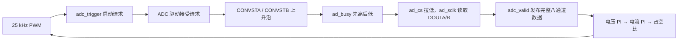

# DCDC 顶层 I/O 端口与引脚配置说明

更新日期：2026-10-04。适用工程：`E:\FPGA_project`，顶层模块 `DCDC_top`，器件 `DR1M90GEG400`，DAQ001 通过 FEP 连接，用户确认子卡为 3.3 V IO 版本。

本说明依据当前 RTL、已保存的 `uisrc/04_pin/fpga_pin.adc` 和板卡原理图编写。全部 24 个顶层端口均为 1 位数字信号。方向以 FPGA 为参照：`input` 表示信号进入 FPGA，`output` 表示信号从 FPGA 输出。

**当前已保存 17 个端口的引脚约束，7 个端口未配置。本文中的“建议”尚未写入约束，不代表已经完成配置。** BANK32 的实际 VADJ1 电压仍待用户确认；软件中的 `LVCMOS33` 不会改变板上供电。

## 1. 全部 24 个端口

以下 Bank 和 Location 来自已保存的约束，并与本次截图对应；“未配置”表示当前文件中没有该端口的引脚约束。

### 1.1 时钟、复位和控制输入：5 个

| 名称 | 方向 | Bank / Location | 代表什么 | 电平与当前行为 |
|---|---|---|---|---|
| `clk_in` | input | BANK33 / H16 | 板载 100 MHz 时钟输入，送入 `PLL_sys100` | 周期 10 ns；这是时钟，不是启动/停止信号。当前约束为 LVCMOS33、PULLUP |
| `rst_n` | input | BANK33 / K14 | 系统复位输入，连接底板 KEY1 | **低电平复位**；KEY1 松开为高，按下为低。复位 PLL、ADC 及控制逻辑；当前为 PULLUP |
| `pll_locked` | output | 未配置 | PLL 锁定状态 | 1 表示 PLL 报告锁定；不是 PWM 运行标志。失锁时当前 RTL 复位 ADC 与控制路径 |
| `control_enable` | input | 未配置 | PI/PWM 控制运行使能 | 1 请求运行，0 停用并复位 PI/PWM。仍需 `rst_n=1`、PLL 锁定且 `pi_clear=0` 才能运行 |
| `pi_clear` | input | 未配置 | PI/PWM 清零输入 | **高电平有效**；为 1 时清零 PI、控制调度和 PWM，四路 PWM 为低。不会重新初始化 ADC |

`rst_n` 中的 `_n` 表示低有效。它与 ADC 的 `ad_rst` 极性相反。

KEY1 是这里使用的 PL 复位按键。底板 KEY4 连接 PS 系统复位，不能把它视为当前 `rst_n` 的同一输入。

当前运行条件可写为：

```text
rst_n=1 且 pll_locked=1 且 control_enable=1 且 pi_clear=0
    -> 经两个 clk_100m 时钟同步释放后，PI/PWM 开始运行
```

输入不能仅因“暂时不用”而留作悬空。未配置的 `control_enable` 和 `pi_clear` 仍然参与运行条件。

### 1.2 PWM 输出：4 个

四路均为 BANK11、LVCMOS33；当前输出驱动强度 8 mA、PullType=NONE。截图中的 SlewRate=MED 为中等输出边沿速度。

| 名称 | 方向 | Location | 底板接线位置 | 当前输出含义 |
|---|---|---|---|---|
| `pwm1_h` | output | Y12 | CEP / J12 第 3 脚 | 第 1 组 H 信号；运行时等于基础 PWM |
| `pwm1_l` | output | Y13 | CEP / J12 第 4 脚 | 第 1 组 L 信号；运行时等于基础 PWM 的反相 |
| `pwm2_h` | output | T9 | CEP / J12 第 5 脚 | 第 2 组 H 信号；当前与 `pwm1_h` 同相 |
| `pwm2_l` | output | U10 | CEP / J12 第 6 脚 | 第 2 组 L 信号；当前与 `pwm1_l` 同相 |

CEP / J12 第 2 脚为 GND，可作为 FPGA 侧数字信号参考地。按排针脚号接线，不要仅凭照片的左右位置判断。

当前关系是：

```text
运行时：pwm1_h = pwm2_h = pwm_base
        pwm1_l = pwm2_l = !pwm_base
停用、清零、复位或 PLL 失锁时：四路输出均为 0
```

PWM 频率为 `100 MHz / 4000 = 25 kHz`，周期 40 us，占空比在 PWM 周期边界更新。H/L 表示工程的输出命名，实际对应哪个功率管仍由驱动接线决定。

当前没有死区；CEP 的 P/N 引脚对命名也不会自动生成互补 PWM 或死区。控制已经运行但占空比为 0 时，H=0、L=1；“占空比为 0”和“停用后四路全低”含义不同。

### 1.3 DAQ001 / AD7606 实体接口：10 个

这 10 个信号均通过 BANK32 所在的 FEP 接口连接子卡，当前全部使用 LVCMOS33。前三个输入使用 PULLUP；其余输出使用驱动强度 8 mA、PullType=NONE。

| 名称 | 方向 | Location | 代表什么 | 电平与当前行为 |
|---|---|---|---|---|
| `ad_busy` | input | R16 | AD7606 芯片的 BUSY 引脚 | 1 表示芯片正在转换；转换结束后变为 0。驱动对它进行两级同步 |
| `ad_dout_a` | input | T16 | AD7606 的 DOUTA 串行数据 | 传送 V1～V4，每通道 16 位；不是模拟电压输入 |
| `ad_dout_b` | input | U17 | AD7606 的 DOUTB 串行数据 | 传送 V5～V8，每通道 16 位，与 A 组并行读取 |
| `ad_convsta` | output | N17 | A 组转换启动 CONVSTA | 空闲为高；驱动先拉低约 40 ns，再拉高，以该上升沿启动采样 |
| `ad_convstb` | output | P18 | B 组转换启动 CONVSTB | 当前与 CONVSTA 同步，使用同一内部转换启动信号 |
| `ad_cs` | output | R18 | ADC 串行接口片选 CS | **低有效**；读取时为低，空闲/复位/故障状态为高 |
| `ad_sclk` | output | P19 | ADC 串行读取时钟 SCLK | 读取时为 12.5 MHz；当前空闲为高，驱动在 SCLK 下降沿采集两路 DOUT |
| `ad_rst` | output | T17 | ADC 芯片 RESET | **高有效**；默认初始化期间保持高约 83.9 ms，之后拉低 |
| `ad_range` | output | P20 | ADC 模拟输入量程选择 RANGE | 当前固定为 0，选择 ±5 V；1 对应 ±10 V |
| `card_power_en` | output | U12 | DAQ001 子卡上电使能 IO_OE | 设计配置生效后固定为 1，不受 `control_enable` 或 `pi_clear` 控制 |

`ad_dout_a/b` 是 3.3 V 数字串行接口；被测模拟电压接 DAQ001 的模拟通道接口。`ad_range=0` 所指的 ±5 V 是模拟输入量程，不是 FPGA IO 电压。

驱动串行读取 64 位时钟序列，同时得到两组各 4 个通道的数据：

```text
adc_data_a = {V1, V2, V3, V4}
adc_data_b = {V5, V6, V7, V8}
每个 Vn 是 16 位有符号补码原始计数
当前控制反馈使用 V2 作为电压，V3 作为电流
```

过采样 OS0～OS2 由该子卡原理图中的电阻配置为 000，没有接到 FEP。顶层 `ad_os` 已移除，驱动的 `O_ad_os` 输出未接到顶层引脚。串行/并行模式选择也由子卡硬件配置，不是本顶层的控制端口。

### 1.4 采样请求和诊断输出：5 个

这些是 FPGA 内部逻辑向外提供的观察信号，不是额外的 AD7606 芯片接口。

| 名称 | 方向 | 当前 Bank / Location | 代表什么 | 电平与当前行为 |
|---|---|---|---|---|
| `adc_trigger` | output | BANK11 / U7，CEP 第 11 脚 | PWM 发出的采样启动请求，同时已在 FPGA 内部接入 ADC 驱动 | 每 PWM 周期一个高脉冲，宽 1 个 100 MHz 时钟，即 10 ns；驱动初始化或忙时可能不接受 |
| `adc_valid` | output | 未配置 | 新的一整帧 ADC 数据已经读完并发布 | 高脉冲宽 10 ns；只有此时内部八通道数据才一起更新 |
| `adc_ready` | output | 未配置 | ADC 驱动可以接收新采样请求 | 1 表示驱动处于空闲、同步 BUSY 为低且没有错误；不是“数据已有效” |
| `adc_busy` | output | 未配置 | FPGA ADC 驱动不处于空闲状态 | 初始化、转换启动、等待 BUSY、串行读出、结束处理及故障状态均为 1 |
| `adc_error` | output | 未配置 | ADC 驱动错误锁存 | BUSY 未按时拉高、BUSY 持续过久、读数期间 BUSY 意外拉高或非法状态时置 1；ADC 系统复位后清除 |

驱动默认 `BUSY_TIMEOUT_CYCLES=1000`，在 100 MHz 下，每个等待 BUSY 阶段的超时门限约为 10 us。

`adc_busy` 的定义是“状态不为空闲”，`adc_ready` 还检查同步 BUSY 和错误，所以不要在外部逻辑中假定二者永远严格互反。

`adc_error` 当前仅用于报告异常，没有直接接入 PWM 关断条件。`pi_clear` 和 `control_enable=0` 不清除 ADC 错误；`rst_n=0` 或 PLL 失锁会触发 ADC 系统复位并清除错误。已开始的正常采样在 PI 清零或控制停用后仍可完成。

## 2. 一次采样中，各信号的先后关系



请求只有在 `adc_ready=1` 时才被驱动接受；初始化或忙状态下到达的请求会丢弃，不排队。因此，看到 `adc_trigger` 不等于已经得到一帧新数据，应以 `adc_valid` 为准。

非零占空比时，采样请求位于 H 高脉冲的中点附近；占空比为 0 时在周期中点，也就是 20 us 处触发。占空比改变会改变请求在周期中的位置，“每周期一次”不代表相邻请求严格相隔 40 us。

## 3. 名字相近、含义不同的信号

| 对比项 | 区别 |
|---|---|
| `ad_busy` / `adc_busy` | 前者来自 ADC 芯片，表示正在转换；后者来自 FPGA 驱动，覆盖初始化、转换、读取、故障等状态 |
| `adc_trigger` / `ad_convsta/b` | 前者是 FPGA 的启动请求；后者是实际送给 ADC 的转换启动波形，忙时被丢弃的请求不会产生新 CONVST |
| `adc_ready` / `adc_valid` | 前者表示现在能接收新请求；后者表示刚获得一帧完整的新数据 |
| `rst_n` / `ad_rst` | 前者是低有效系统复位输入；后者是高有效 ADC 芯片复位输出 |
| `control_enable` / `card_power_en` | 前者决定控制与 PWM 是否运行；后者决定子卡供电使能，当前固定为 1 |
| `clk_in` / `ad_sclk` | 前者是输入 FPGA 的 100 MHz 系统参考时钟；后者是 FPGA 向 ADC 输出的 12.5 MHz 串行读取时钟 |

## 4. Anlogic I/O 配置表各列是什么意思

| 列名 | 含义 | 本工程如何理解 |
|---|---|---|
| Name | 顶层端口名字 | 必须与 `DCDC_top` 的端口名一致 |
| Direction | 相对 FPGA 的信号方向 | `input` 进入 FPGA，`output` 从 FPGA 输出；由 RTL 决定 |
| Bank | 引脚所属的 IO 供电组 | BANK11、32、33 是实际 DR1 的 Bank；底板图中的 B13/B34/B35 网络名不能直接当作 DR1 Bank 编号 |
| Location | 芯片封装引脚号 | 例如 Y12、R16；不是 CEP/FEP 排针的脚号，需要按原理图换算 |
| IOStandard | 输入/输出电气标准 | `LVCMOS33` 是 3.3 V CMOS 接口标准，必须与实际 Bank 电压及外接器件匹配 |
| DriveStrength | 输出驱动强度，单位 mA | `8` 表示 8 mA 档位，不表示持续输出恒定 8 mA；输入通常显示 NA |
| PullType | 内部弱上拉、弱下拉或不使用弱拉 | PULLUP 偏向高，PULLDOWN 偏向低，NONE 不启用；不能替代外部正常信号源 |
| PreEmphasis | 输出预加重，用于调整高速信号边沿/波形 | 当前显示 NA，表示此配置下不适用；本工程没有据此启用预加重 |
| SlewRate | 输出上升/下降边沿速度 | MED 为中等；它不决定 PWM 的 25 kHz 频率 |
| DiffResistor | 差分输入片上端接电阻 | 当前是单端 LVCMOS 信号，显示 NA；不需要因 CEP 有 P/N 命名就配置差分端接 |
| ODT | 片上端接选项 | 当前显示 OFF；不能将它解释为“输出关闭” |
| PCIClamp | PCI 相关输入钳位选项 | 当前显示 NA；它不是外接电路的过压保护方案 |
| Hysteresis | 输入迟滞功能 | 当前已配置输入显示 ON；改善输入门限附近的抗抖动能力，不等于按键消抖或两级同步 |
| VREF | 某些 IO 电平标准所需的输入参考电压 | 当前 LVCMOS33 显示 NA；不是 ADC 的模拟基准电压 |
| PackReg | 输入/输出寄存器是否打包到 IO pad 资源中 | AUTO 表示按全局设定处理；不表示可以跳过 RTL 寄存器或时序分析 |
| InDelay | IO 输入路径的可编程硬件延迟 | NONE 表示未指定该延迟功能；不是 SDC 的 `set_input_delay` 外部时序约束 |
| OutDelay | IO 输出路径的可编程硬件延迟 | NONE 表示未指定该延迟功能；不是 SDC 的 `set_output_delay`，也不是 PWM 死区 |
| DifferentialPair | 差分配对相关信息/设置 | 本工程信号是独立的单端 IO，不需将 H/L 输出设为 LVDS 差分对 |

`NA` 表示该项在当前方向、器件或电平标准下不适用。`NONE` 是明确不启用相应选项。空白表示界面当前没有显示设置，不能把空白理解成硬件已经固定为 0。

`.adc` 在本工程中是 TD 的引脚/IO 属性约束文件扩展名，与 AD7606 模数转换数据文件无关。

## 5. 尚未配置的 7 个端口：可采用的接线方案

以下只是保留当前顶层端口时的建议；本文没有修改约束文件。方案与已保存的 17 个引脚不重复。全部采用 LVCMOS33。

| 未配置端口 | 建议 Bank / Location | 板上位置 | 建议属性 | 使用方法 |
|---|---|---|---|---|
| `control_enable` | BANK11 / T5 | CEP / J12 第 7 脚 | input，PULLDOWN | 外部开关/跳帽给高电平时请求运行；默认低电平停用 |
| `pi_clear` | BANK11 / U5 | CEP / J12 第 8 脚 | input，PULLDOWN | 外部高电平清零；正常运行保持低 |
| `pll_locked` | BANK33 / M20 | LED4 | output，8 mA，NONE | PLL 锁定时 LED4 亮 |
| `adc_error` | BANK33 / J15 | LED3 | output，8 mA，NONE | ADC 错误锁存时 LED3 亮 |
| `adc_busy` | BANK11 / V6 | CEP / J12 第 9 脚 | output，8 mA，NONE | 接逻辑分析仪观察驱动状态 |
| `adc_ready` | BANK11 / W6 | CEP / J12 第 10 脚 | output，8 mA，NONE | 接逻辑分析仪观察是否可以接收请求 |
| `adc_valid` | BANK11 / V7 | CEP / J12 第 12 脚 | output，8 mA，NONE | 接示波器/逻辑分析仪观察采样完成脉冲 |

`adc_trigger` 已配置为 U7，对应 CEP 第 11 脚，不在上述未配置列表中。

输出边沿可沿用当前 MED，其余适用项可保持默认。当前 `clk_in` 的已保存 PullType 是 PULLUP，本文如实记录；前面建议过的 NONE 未写入文件。板载时钟由有源振荡器驱动，弱上拉不会生成时钟；后续如需调整，可单独核对并修改约束。

若某些诊断信号只准备通过 ChipWatcher 在 FPGA 内部观察，也可以另行修改顶层、移除对应外部观察端口。保留为顶层端口时，它们仍然属于外部 IO，不能仅因为用途是“调试”就长期忽略引脚分配。

## 6. 接线和观察要点

1. BANK11、BANK33 的这些信号按本地板卡资料为 3.3 V IO。BANK32 由 VADJ1 供电，需确认实际为 3.3 V，才能与用户的 3.3 V 版 DAQ001 及当前 LVCMOS33 配置匹配。
2. `card_power_en` 是供电使能逻辑信号；固定输出 1 不代表子卡已被实测正常供电。FPGA 未配置时的引脚状态也不能用这条 RTL 常量赋值推断。
3. `adc_trigger`、`adc_valid` 只有 10 ns 宽，不能直接用 LED 判断是否有采样。用于外部捕获时，仪器带宽、采样率及触发方式需能观察该短脉冲；ChipWatcher 可使用内部 100 MHz 时钟采集。
4. `rst_n` 会重新初始化 ADC；`pi_clear` 和 `control_enable=0` 只复位/停用控制路径，不重新初始化 ADC，也不清除 `adc_error`。
5. H/L 输出用于驱动器的逻辑输入，不能直接驱动 MOSFET 栅极。当前没有死区，本文的引脚映射不代表已经完成实际功率级驱动验证。
6. H16 除引脚位置外，还需要 100 MHz、周期 10 ns 的时钟时序约束。I/O 表中的 InDelay/OutDelay 不能替代时序约束和布局布线检查。

## 7. 文档依据与验证范围

当前工程文件：

- [顶层端口及内部连接 DCDC_top.v](/E:/FPGA_project/uisrc/01_rtl/DCDC_top.v)
- [已保存的引脚约束 fpga_pin.adc](/E:/FPGA_project/uisrc/04_pin/fpga_pin.adc)
- [AD7606 驱动 uispi7606.v](/E:/FPGA_project/uisrc/03_ip/AD7606/uispi7606.v)
- [PWM 发生器 PWM.v](/E:/FPGA_project/uisrc/01_rtl/PWM.v)

本地硬件资料：

- [底板原理图 MLK_F3P_DR1_250526.pdf](/E:/baiduDownload/02_F3P_DR1M90GEG400/板卡资料/02_hardware/hardware_MLK_F3P_CZ02_DR1_20250526/02_原理图/MLK_F3P_DR1_250526.pdf)：PDF 第 3 页时钟、第 13 页 LED/KEY、第 15 页 FEP、第 16 页 CEP。
- [核心板原理图 MLK_CZ02_DR1_240926.pdf](/E:/baiduDownload/02_F3P_DR1M90GEG400/板卡资料/02_hardware/hardware_MLK_F3P_CZ02_DR1_20250526/02_原理图/MLK_CZ02_DR1_240926.pdf)：PDF 第 4 页 DR1 IO 与 Bank。
- [开发板硬件使用手册](/E:/baiduDownload/02_F3P_DR1M90GEG400/板卡资料/02_hardware/hardware_MLK_F3P_CZ02_DR1_20250526/01_硬件手册/MLK_F3P_CZ02_DR1开发板硬件使用手册.pdf)：第 12 页 PL 时钟，第 20～21 页 LED/KEY，第 23 页 CEP，第 24 页 VADJ1/BANK32。
- [UG1210 DR1 IO 用户手册](/E:/baiduDownload/02_F3P_DR1M90GEG400/板卡资料/02_hardware/hardware_MLK_F3P_CZ02_DR1_20250526/06_芯片手册/01_DR1/UG1210_安路科技DR1系列FPSoC IO用户手册-米联客.pdf)：PDF 第 5 页 IO 能力，第 8～11 页供电、位置、驱动、弱拉、PackReg、输入/输出延迟。
- [DAQ001 厂家硬件资料压缩包](/E:/baiduDownload/02_F3P_DR1M90GEG400/板卡资料/01_start/01_start_fpga/03_mlk_card_demo/MLK_FEP_DAQ001/02_hardware/FEP-DAQ001-HW-20250108.zip)：其中的 `02_原理图/FEP-DAQ001-K200L8B16-N01.pdf` 第 1 页，包含 OS 电阻配置与子卡供电使能。

本文完成的是端口含义、约束文件和本地资料之间的代码/文档核对，不新增 RTL 仿真、综合时序或开发板验证结论。源码描述的时钟、脉宽和频率均以实际 100 MHz 系统时钟正常工作为前提。
